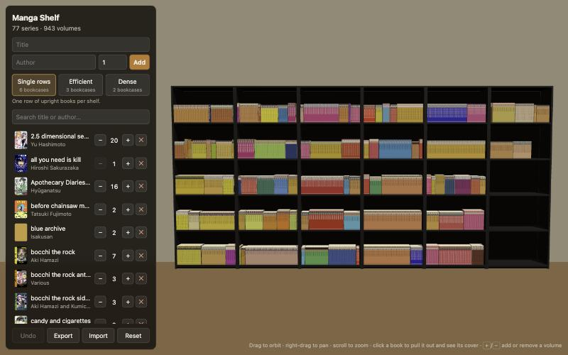
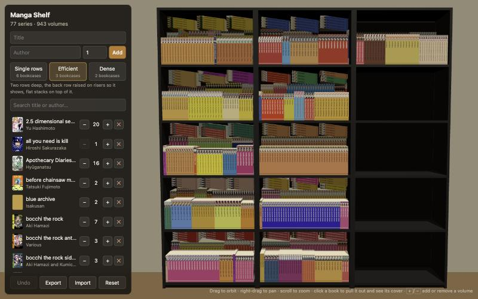

# Manga Shelf

A 3D view of a manga collection, built with [three.js](https://threejs.org). Every volume sits on a
bookcase you can orbit around, with real cover art, and you can add or remove books from a side panel.



## What it does

- **Shows the whole collection in 3D.** Each series gets its own spine, drawn from its cover art.
- **Add and remove books.** Use `+` / `−` on a series to change its volume count, `✕` to remove the
  series, or the form at the top to add a new one. Undo reverses any change.
- **Shows the cover.** Click a book and it slides out and turns to face you.
- **Finds a series.** Search by title or author, then click the row and the camera flies to it.
- **Repacks the shelves.** Three layouts show how many bookcases the collection needs:

  | Layout | How books are placed |
  | --- | --- |
  | Single rows | One row of upright books per shelf |
  | Efficient | Two rows deep, the back row raised on risers so it stays visible, flat stacks on top of it |
  | Dense | Two rows deep with flat stacks on top of both rows; holds the most, but hides the back row |




## Install

You need [Node.js](https://nodejs.org) 20.19 or newer (which includes `npm`) and
[git](https://git-scm.com).

1. Download the project:

   ```bash
   git clone https://github.com/oherna25/manga-organizer.git
   ```

2. Go into the project folder:

   ```bash
   cd manga-organizer
   ```

3. Install the dependencies:

   ```bash
   npm install
   ```

4. Start the app:

   ```bash
   npm run dev
   ```

5. Open the address it prints, normally <http://localhost:5173>, in your browser.

To stop the app, press `Ctrl+C` in the terminal.

## Controls

| Action | How |
| --- | --- |
| Orbit | Drag |
| Pan | Right-drag |
| Zoom | Scroll |
| See a book's cover | Click the book (click again or press `Esc` to put it back) |
| Add or remove a volume of the selected series | `+` / `−` |

## Using your own collection

The collection starts from `src/collection.json`, a list of series:

```json
[{ "title": "one piece", "author": "Eiichiro Oda", "count": 90 }]
```

Edits you make in the app are saved in your browser, not in that file. **Export** downloads the
current collection as JSON, **Import** loads one, and **Reset** goes back to `src/collection.json`.

To build `src/collection.json` from a spreadsheet with `title`, `author` and `number of books`
columns (needs Python 3):

```bash
python3 scripts/import-xlsx.py "/path/to/manga sheet.xlsx"
```

Then look up cover art for it:

```bash
node scripts/fetch-covers.mjs
```

That writes `src/covers.json`. If a series gets the wrong cover, or none, edit
`scripts/cover-overrides.json` and run the command again:

- `search` maps a title to a better search phrase, for nicknames such as `komi`.
- `ids` pins a title to an exact AniList manga id, or to `null` to skip it.

## Notes

- Cover art comes from [AniList](https://anilist.co) and is loaded from there when the app runs, so
  covers need an internet connection. Adding a series in the app sends its title to AniList to find
  a cover.
- AniList has one cover per series, so every volume of a series shows the same cover.
- Spines are generated from the cover's colour and art. They are not scans of the printed spines.
- The bookcase is modelled on the Room Essentials 5 Shelf Bookcase (71.18 × 24.49 × 11.57 in).
- Book thickness and height are generated per series, not measured, so bookcase counts are estimates.
